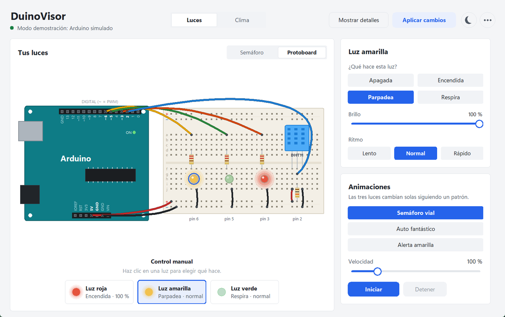

# DuinoVisor — control de Arduino en tiempo real con Python

App de escritorio (Tkinter + pyserial), pensada para quien no sabe nada de Arduino, que detecta sola la placa,
configura 3 LEDs (apagado, fijo con brillo, parpadeo, respiración) y muestra temperatura y humedad
del DHT11 en vivo. El sketch del Arduino no usa `delay()`: todo va con `millis()`.

Funciones: secuencias (semáforo vial, auto fantástico, alerta) con pausa, velocidad y detención, un
**semáforo 3D y una vista de protoboard que espejan al Arduino**, semáforo térmico, escenas `.json`, exportar lecturas a
CSV y alarmas por temperatura o humedad.

## Contenido

| Ruta | Qué es |
| --- | --- |
| `arduino/control_leds/control_leds.ino` | Sketch (carpeta y archivo con el mismo nombre, como pide el IDE) |
| `main.py` | Arranque; `--demo` usa el Arduino simulado |
| `gui.py` | Ventana Tkinter: pestañas Luces y Clima, editor del LED elegido, panel de detalles técnicos y Ajustes |
| `tema.py`, `widgets.py` | Temas claro y oscuro con 5 colores de acento, y widgets propios dibujados en Canvas (tarjetas, píldoras, selectores, deslizador, interruptor, medidor, barras, chips de LED y semáforo 3D) |
| `vista_placa.py` | Vista de protoboard: placa, protoboard, LEDs con su resistencia y DHT11, con los pines del sketch |
| `preferencias.py` | Guarda el tema y el color elegidos (`%APPDATA%\DuinoVisor\ajustes.json` o `~/.config/duinovisor/`) |
| `protocol.py` | Órdenes, validación, interpretación de líneas, qué enviar al pulsar Aplicar, tabla de secuencias y modelo local que espeja al Arduino (funciones puras) |
| `arduino_link.py` | Puertos, autodetección, hilo lector con cola, envío |
| `grafica.py` | Gráfica de área en vivo sobre un Canvas |
| `escenas.py`, `exportar.py`, `alarmas.py` | Escenas `.json` validadas, CSV de lecturas y alarmas con histéresis |
| `simulador.py` | Arduino falso con la misma lógica del sketch |
| `docs/vista_previa.png`, `docs/vista_protoboard.png` | Capturas de la ventana (modo demo, tema claro) |
| `tests/` | `test_protocol`, `test_extras`, `test_simulador`, `test_gui_logica` (Python) y `test_sketch` (compila el `.ino` con g++ contra un Arduino simulado) |

## Instalación y uso

```bash
pip install pyserial            # Python 3.10+
# Linux (Ubuntu/Debian): Tkinter y permisos del puerto
sudo apt install python3-tk
sudo usermod -aG dialout $USER  # cerrar sesión y volver a entrar

python main.py --demo           # sin placa
python main.py                  # con la placa: se conecta sola
```

Cargar el sketch: en el IDE de Arduino instala las librerías **DHT sensor library** y
**Adafruit Unified Sensor**, abre `control_leds.ino`, elige la placa (*Arduino 101*, o *Arduino UNO*) y sube.
La app solo funciona con este sketch cargado: con otro (por ejemplo un ejemplo de la librería DHT11) la placa
no responde a `PING`, la autodetección falla y las órdenes quedan «sin respuesta».
Cierra el Monitor Serie antes de abrir la app (el puerto solo lo puede usar un programa).

Probar a mano desde el Monitor Serie (9600 baudios, "Nueva línea"): `PING`, `LED G ON 128`,
`LED Y BLINK 255 500 250`, `LED R FADE 200 2000`, `DHT 2000`, `TERMO 22 28`, `SEQ VIAL`, `SEQ PAUSA`,
`SEQ SEGUIR`, `SEQ OFF`, `STATUS`.

## Conexiones

| Componente | Pin | Conexión |
| --- | --- | --- |
| LED rojo | 3 (PWM) | pin → 220 Ω → ánodo (pata larga); cátodo → GND |
| LED verde | 5 (PWM) | igual |
| LED amarillo | 6 (PWM) | igual |
| DHT11 VCC | 5V | directo |
| DHT11 DATA | 2 | directo + 10 kΩ entre DATA y 5V (si es módulo de 3 patas ya la trae) |
| DHT11 GND | GND | directo |

Sensor suelto de 4 patas: la tercera no se conecta. En el Arduino 101 solo 3, 5, 6 y 9 tienen PWM (10 y 11 no),
por eso los LEDs van en 3, 5 y 6.

## Protocolo (9600 baudios, texto, una orden por línea)

| PC → Arduino | Qué hace |
| --- | --- |
| `PING` | Responde `PONG OAC-LEDS 1` |
| `LED <R\|G\|Y> OFF` | Apaga |
| `LED <c> ON <brillo 0-255>` | Encendido fijo |
| `LED <c> BLINK <brillo> <on_ms> <off_ms>` | Intermitente (mínimo 20 ms) |
| `LED <c> FADE <brillo> <periodo_ms>` | Respiración (mínimo 200 ms) |
| `DHT <periodo_ms>` | Cada cuánto se lee el sensor (mínimo 1000 ms) |
| `TERMO <tmin> <tmax>` / `TERMO OFF` | Semáforo térmico |
| `SEQ <VIAL\|FANTASTICO\|ALERTA> [vel]` | Inicia la secuencia; `vel` es el % de velocidad (25-400, por defecto 100) |
| `SEQ PAUSA` / `SEQ SEGUIR` / `SEQ OFF` | Pausa (los LEDs se quedan como están), continúa o detiene y apaga |
| `STATUS` | Una línea `STATE <c> <modo> <brillo> <on> <off> <periodo>` por LED, una `STATE SEQ <nombre> <vel> <RUN\|PAUSA>` (o `STATE SEQ OFF`) y `OK STATUS` |

| Arduino → PC | Cuándo |
| --- | --- |
| `DATA T=24.0 H=51.0` / `DATA ERR` | Cada periodo del DHT / el sensor no respondió |
| `OK …` / `ERR <motivo>` | Respuesta a cada orden |

## La ventana


- **Luces**: el semáforo ocupa el centro. Haz clic en una luz (o en su chip de abajo) y elige en el panel de la
  derecha qué hace: *Apagada*, *Encendida*, *Parpadea* o *Respira*, con su brillo y un ritmo *Lento / Normal /
  Rápido*. El conmutador **Semáforo | Protoboard** muestra el montaje real (placa, protoboard, resistencias,
  cables y DHT11); ahí también se elige un LED con un clic, y al pasar el ratón se ve su pin.
  Debajo, las **Animaciones** (secuencias). Los cambios se envían con **Aplicar cambios** (o Ctrl+Intro).
- **Clima**: temperatura, humedad, gráfica de los últimos minutos, avisos y el semáforo según la temperatura.
- **Mostrar detalles** enseña lo técnico: puerto serie y conexión, registro de órdenes enviadas y recibidas,
  milisegundos exactos de cada LED, valor PWM, pin y cada cuánto se lee el sensor.
- **⋯** abre el menú: guardar o cargar escena, exportar CSV y **Ajustes** (tema claro u oscuro y color de
  acento). El botón de la luna o el sol cambia de tema al momento; la elección se recuerda.
- En Windows con escalado de pantalla (125 %, 150 %) la ventana se dibuja a la resolución real, sin verse borrosa.



## Secuencias y semáforo espejo

| Secuencia | Pasos |
| --- | --- |
| `VIAL` | verde 5 s, amarillo 1,5 s, rojo 5 s |
| `FANTASTICO` | rojo, amarillo, verde, amarillo, 150 ms cada uno |
| `ALERTA` | amarillo 0,5 s encendido y 0,5 s apagado |

La velocidad escala todas las duraciones (mínimo 20 ms por paso). Una orden `LED` manual, `TERMO` o `SEQ` nuevo
cancela lo anterior: **la última orden manda**.

El semáforo 3D, la protoboard y los chips de cada luz no leen nada del Arduino: calculan lo mismo con el modelo de
`protocol.py` (`SecuenciaLocal`, `brillo_en`, `zona_termo`), arrancando en el instante en que el Arduino
confirmó la orden con `OK`. Las pruebas comparan ese modelo con el sketch milisegundo a milisegundo.
Pausar, seguir o detener en la app manda la orden al Arduino, y si se desconecta o se cierra la app con una
secuencia en marcha, la app envía `SEQ OFF` antes. El semáforo térmico, en cambio, sigue funcionando solo.

## Escenas, CSV y alarmas

- **Escenas**: *Guardar escena* y *Cargar escena* guardan en un `.json` los tres LEDs, el periodo del sensor, el
  semáforo térmico y la secuencia elegida. Al cargar se valida todo; si algo está mal no se cambia nada. Después
  hay que pulsar *Aplicar* para enviarla.
- **Exportar CSV**: guarda cada lectura con fecha y hora (las fallidas quedan como «error de sensor»). Se
  conservan las últimas 100 000 lecturas. El archivo abre bien en Excel.
- **Alarmas**: avisan en la ventana (franja roja, registro y pitido del sistema) si la temperatura o la humedad
  superan su máximo, y avisan de nuevo cuando vuelven a la normalidad (con 1 unidad de histéresis). Una
  lectura fallida no apaga ni dispara una alarma.

## Decisiones de diseño (cambios respecto al borrador)

- **Aplicar espera `OK`/`ERR` de cada orden** antes de enviar la siguiente (reintenta una vez si no hay
  respuesta). Una configuración solo se da por aplicada cuando el Arduino la confirmó.
- **Semáforo térmico con histéresis de 1 °C**: sube de zona al instante y baja solo si la temperatura cae
  1 °C por debajo del umbral. El DHT11 tiene ±2 °C de error y resolución de 1 °C; sin histéresis parpadearía.
- **Prioridad entre TERMO y los LEDs**: la última orden manda. Una orden `LED` cancela el semáforo y deja
  los LEDs apagados salvo el ordenado. En la ventana, al activar el semáforo el editor de LEDs muestra
  un aviso en lugar de los controles; al desactivarlo, Aplicar manda `TERMO OFF` y reenvía los tres LEDs. Si el sensor falla
  (`DATA ERR`), el semáforo conserva la última zona.
- **Respiración con corrección gamma** (brillo × x²): una rampa lineal de PWM se ve poco natural.
- **Línea de más de 63 caracteres**: se descarta y se responde `ERR linea larga`.
- **Al conectar**: abrir el puerto reinicia el UNO, pero no el Arduino 101 (USB nativo), que puede seguir con
  LEDs, semáforo o secuencia de antes. Por eso, al conectar con la placa real la app envía `TERMO OFF` (lo apaga
  todo), olvida lo aplicado y reenvía todo al pulsar Aplicar.
- **Líneas troceadas**: la app junta lo que llega del puerto hasta el salto de línea; si una línea llega en
  varios paquetes no se parte.

## Limitaciones conocidas

- **No se ha probado con la placa real.** El sketch se compila y prueba contra un Arduino simulado en C++
  (más de 50 pruebas, incluida la comparación con el modelo de la app); la lógica de la ventana se probó con un
  Tkinter de mentira, y la ventana real se abrió en Windows 11 en modo demo (capturas en `docs/`). Falta
  probarla en Linux y con la placa conectada.
- **Lectura del DHT11**: la librería desactiva las interrupciones unos 4–5 ms y bloquea ~25 ms. Una orden que
  llegue justo entonces podría perder algún carácter; por eso la app espera confirmación y reintenta.
  Si lo ves en la placa real, avísame o sube a 115200 baudios y mide.
- **LEDs virtuales**: aparecen siempre, también con la placa real, calculados desde lo que el Arduino confirmó.
  Si alguien cambia los LEDs sin pasar por la app (por ejemplo desde el Monitor Serie), el espejo no se entera.
- **Tkinter no dibuja sombras suaves ni transparencias**: el brillo de los LEDs usa anillos concéntricos y el
  área de la gráfica, franjas de un color mezclado con el fondo.

## Pruebas

```bash
python -m pytest tests -q       # el test del sketch necesita g++
```

## Extras pendientes

Ninguno de los extras del documento queda pendiente. Ideas para más adelante: secuencias definidas por el
usuario, alarmas con mínimo, y sonido o parpadeo en el Arduino cuando salta una alarma.
