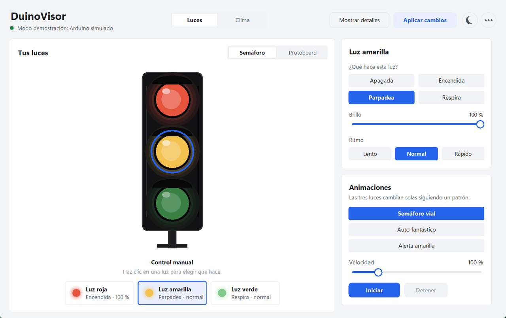
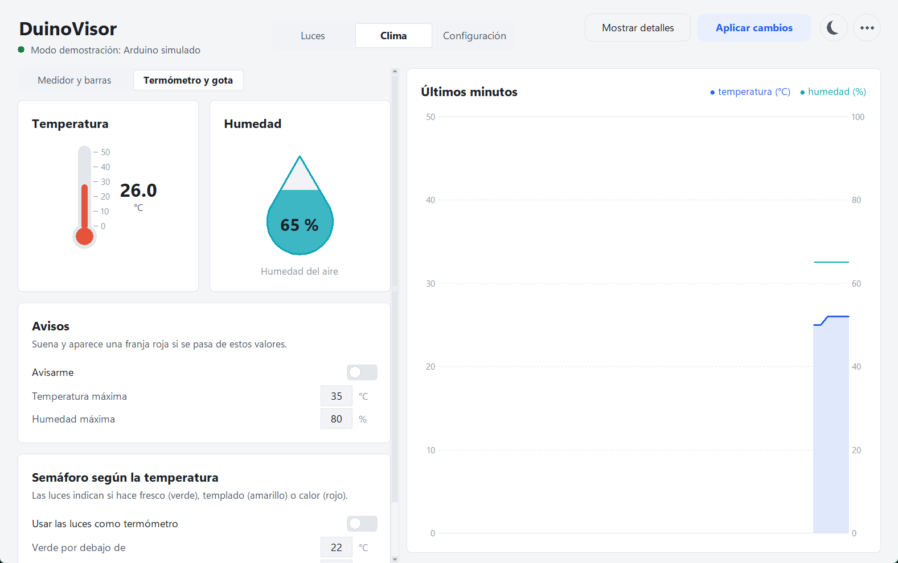
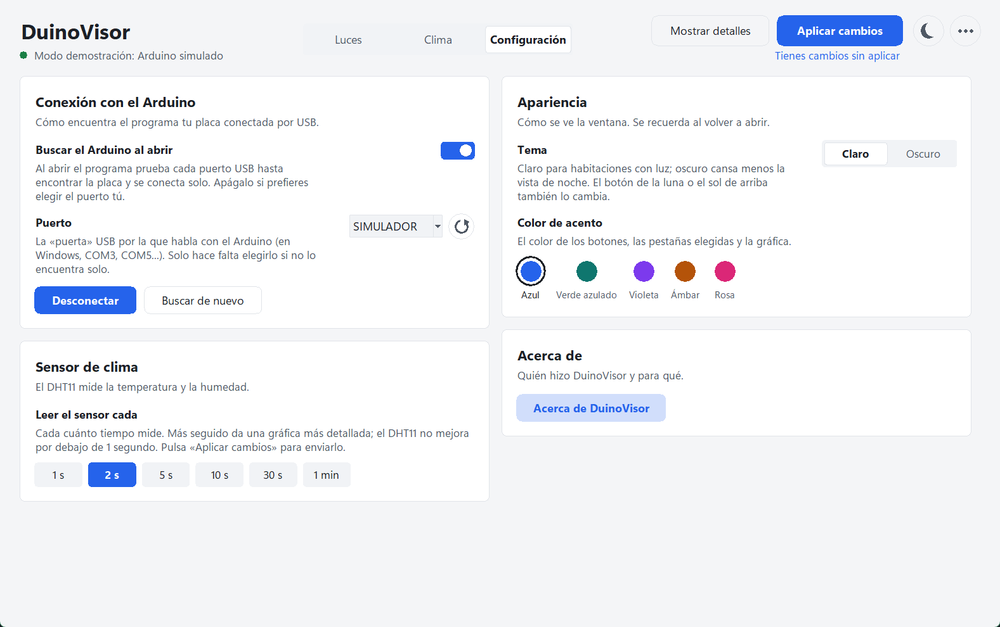

# DuinoVisor — control de Arduino en tiempo real con Python

App de escritorio (Tkinter + pyserial), pensada para quien no sabe nada de Arduino, que detecta sola la placa,
configura sus LEDs (de serie, rojo, verde y amarillo: apagado, fijo con brillo, parpadeo, respiración) y
muestra temperatura y humedad del DHT11 en vivo. Probada con un **Arduino 101** real. El sketch del Arduino no usa `delay()`: todo va con `millis()`.

Funciones: secuencias (semáforo vial, auto fantástico, alerta) con pausa, velocidad y detención, un
**semáforo 3D y una vista de protoboard que espejan al Arduino**, semáforo térmico, escenas `.json`, exportar lecturas a
CSV y alarmas por temperatura o humedad.

## Contenido

El código está organizado en capas; cada una solo depende de las de dentro (la prueba
`tests/test_arquitectura.py` lo hace cumplir). Detalles y guía para añadir funciones en
[`docs/ARQUITECTURA.md`](docs/ARQUITECTURA.md).

```
duino-visor/
├── main.py                     atajo: python main.py [--demo]
├── pyproject.toml              paquete, dependencias y configuración de pytest
├── duinovisor/
│   ├── __main__.py             arranque (python -m duinovisor)
│   ├── dominio/                reglas puras: sin Tkinter, sin puerto serie, sin archivos
│   │   ├── leds.py             LedConfig, validación y brillo en cada instante
│   │   ├── protocolo.py        órdenes, respuestas y qué enviar al pulsar Aplicar
│   │   ├── secuencias.py       tabla de animaciones y su copia local
│   │   ├── termometro.py       semáforo térmico con histéresis
│   │   ├── alarmas.py          alarmas por máximo/mínimo con histéresis
│   │   └── placa.py            catálogo de componentes: cada LED (letra, pin, color) y el DHT11
│   ├── hardware/               enlace.py (puerto serie, autodetección) y simulador.py
│   ├── almacenamiento/         escenas.py, exportar.py (CSV) y preferencias.py
│   └── ui/                     única capa con Tkinter
│       ├── app.py              App: une vistas y controladores, bucle y recepción
│       ├── tema.py             temas claro/oscuro, acentos y tipografía
│       ├── constantes.py       textos y ajustes compartidos de la ventana
│       ├── estado_led.py       variables editables de cada LED
│       ├── fichas.py           textos de la ficha de cada componente de la protoboard
│       ├── vistas/             cabecera, luces, clima, configuracion, detalles, acerca (crean widgets)
│       ├── controladores/      conexión, envío, espejo, secuencias, archivos, sensor
│       └── widgets/            base, contenedores, botones, controles, luces, indicadores,
│                               grafica y protoboard (dibujados en Canvas)
├── firmware/control_leds/      sketch (carpeta y archivo con el mismo nombre, como pide el IDE)
├── docs/                       ARQUITECTURA.md y capturas
└── tests/                      misma estructura: dominio/, hardware/, almacenamiento/, ui/,
                                firmware/ (contrato con el .ino y pruebas con g++) y test_arquitectura.py
```

## Instalación y uso

```bash
pip install -e .                # Python 3.10+; instala pyserial, Pillow y el comando «duinovisor»
# Linux (Ubuntu/Debian): Tkinter y permisos del puerto
sudo apt install python3-tk
sudo usermod -aG dialout $USER  # cerrar sesión y volver a entrar

python -m duinovisor --demo     # sin placa (también: python main.py --demo)
python -m duinovisor            # con la placa: se conecta sola
```

Cargar el sketch: en el IDE de Arduino instala el paquete de placas **Intel Curie Boards** (para el Arduino 101) y
las librerías **DHT sensor library** y **Adafruit Unified Sensor**; abre `firmware/control_leds/control_leds.ino`,
elige la placa (*Arduino 101*, o *Arduino UNO*) y sube.
La app solo funciona con este sketch cargado: con otro (por ejemplo un ejemplo de la librería DHT11) la placa
no responde a `PING`, la autodetección falla y las órdenes quedan «sin respuesta».
Cierra el Monitor Serie antes de abrir la app (el puerto solo lo puede usar un programa).

Probar a mano desde el Monitor Serie (9600 baudios, "Nueva línea"): `PING`, `LED G ON 128`,
`LED Y BLINK 255 500 250`, `LED R FADE 200 2000`, `DHT 2000`, `TERMO 22 28`, `SEQ VIAL`, `SEQ PAUSA`,
`SEQ SEGUIR`, `SEQ OFF`, `STATUS`.

## Conexiones

| Componente | Pin | Conexión |
| --- | --- | --- |
| LED rojo | 3 (PWM) | pin → 220 Ω → ánodo (pata larga); cátodo → GND |
| LED verde | 5 (PWM) | igual |
| LED amarillo | 6 (PWM) | igual |
| DHT11 VCC | 5V | directo |
| DHT11 DATA | 2 | directo + 10 kΩ entre DATA y 5V (si es módulo de 3 patas ya la trae) |
| DHT11 GND | GND | directo |

Sensor suelto de 4 patas: la tercera no se conecta. En el Arduino 101 solo 3, 5, 6 y 9 tienen PWM (10 y 11 no),
por eso los LEDs van en 3, 5 y 6. Montaje comprobado con la placa real.

### Añadir un LED

Los LEDs salen de una sola lista, `LEDS` en `duinovisor/dominio/placa.py`. Para sumar uno (por ejemplo azul en
el pin 9, el último con PWM libre en el 101):

1. Una línea en `LEDS`: `Led("B", "Azul", "Luz azul", pin=9, color="#3b82f6", fila=3, columna=3)`. `fila` es
   su posición de arriba abajo en el semáforo y `columna`, de izquierda a derecha en la vista protoboard.
2. La misma línea en la tabla `leds[]` del sketch, en el mismo orden: `{ 'B',  9, M_OFF, 0, 0, 0, 0, 0, false, -1 },`
3. Montarlo como los otros: pin → 220 Ω → ánodo; cátodo → GND.

El resto se adapta solo: protocolo, simulador, semáforo, protoboard, chips, editor y escenas. Las animaciones
lo dejan apagado hasta que algún paso lo nombre: en Python, `(150, {"B": 255})` en
`dominio/secuencias.py`; en el sketch, una columna más en ese paso. `tests/firmware/test_contrato.py`
avisa si la lista de Python y la del sketch no coinciden. Las escenas guardadas antes no se podrán cargar,
porque les falta el LED nuevo.

## Protocolo (9600 baudios, texto, una orden por línea)

| PC → Arduino | Qué hace |
| --- | --- |
| `PING` | Responde `PONG OAC-LEDS 1` |
| `LED <R\|G\|Y> OFF` | Apaga (`<c>` es la letra de un LED de `placa.py`; si no existe responde `ERR led R G Y`) |
| `LED <c> ON <brillo 0-255>` | Encendido fijo |
| `LED <c> BLINK <brillo> <on_ms> <off_ms>` | Intermitente (mínimo 20 ms) |
| `LED <c> FADE <brillo> <periodo_ms>` | Respiración (mínimo 200 ms) |
| `DHT <periodo_ms>` | Cada cuánto se lee el sensor (mínimo 1000 ms) |
| `TERMO <tmin> <tmax>` / `TERMO OFF` | Semáforo térmico |
| `SEQ <VIAL\|FANTASTICO\|ALERTA> [vel]` | Inicia la secuencia; `vel` es el % de velocidad (25-400, por defecto 100) |
| `SEQ PAUSA` / `SEQ SEGUIR` / `SEQ OFF` | Pausa (los LEDs se quedan como están), continúa o detiene y apaga |
| `STATUS` | Una línea `STATE <c> <modo> <brillo> <on> <off> <periodo>` por LED, una `STATE SEQ <nombre> <vel> <RUN\|PAUSA>` (o `STATE SEQ OFF`) y `OK STATUS` |

| Arduino → PC | Cuándo |
| --- | --- |
| `DATA T=24.0 H=51.0` / `DATA ERR` | Cada periodo del DHT / el sensor no respondió |
| `OK …` / `ERR <motivo>` | Respuesta a cada orden |

## La ventana



- **Luces**: el semáforo ocupa el centro. Haz clic en una luz (o en su chip de abajo) y elige en el panel de la
  derecha qué hace: *Apagada*, *Encendida*, *Parpadea* o *Respira*, con su brillo y un ritmo *Lento / Normal /
  Rápido*. El conmutador **Semáforo | Protoboard** muestra el montaje real (placa, protoboard, resistencias,
  cables y DHT11, con sombras, relieve y LEDs que iluminan la protoboard). En la protoboard:
  - **Navegar**: la rueda del ratón acerca o aleja alrededor del puntero (con zoom suave), se arrastra para
    moverse y la barra flotante tiene **− / % / + / ajustar**. Con el teclado: + y −, 0 para verlo todo, las
    flechas para moverse. Un doble clic en un hueco también lo muestra todo.
  - **Explorar**: al pasar el ratón por una pieza se ilumina su cable hasta el pin del Arduino y aparece una
    ayuda. Un clic en un LED lo elige para editarlo; un clic en el DHT11 lo marca. La pieza elegida tiene un
    anillo que «respira»; si es un LED encendido, se ve la corriente recorrer su cable, y con cada lectura del
    sensor un pulso viaja hasta el pin 2.
  - **Ficha**: una tarjeta flotante con qué es la pieza, a qué está conectada, qué hace y cómo está ahora (con su
    brillo o la humedad en vivo). Entra deslizándose, se cierra con × o Esc y se reabre con el botón **Ficha** o
    al hacer clic en otra pieza. Su botón lleva al editor del LED o a la pestaña Clima.

  A la derecha, las **Animaciones** (secuencias). Los cambios se envían con **Aplicar cambios** (o Ctrl+Intro).
- **Clima**: temperatura y humedad, la gráfica de los últimos minutos, los avisos y el semáforo según la
  temperatura. Un conmutador cambia entre **Medidor y barras** y **Termómetro y gota** (un termómetro de tubo y
  una gota que se llena con la humedad); la elección se recuerda.
- **Configuración** reúne los ajustes, cada uno con una frase que explica qué cambia:
  - **Conexión**: buscar el Arduino al abrir (se puede apagar), el puerto, *Conectar* y *Buscar de nuevo*.
  - **Sensor**: cada cuánto se lee (de 1 s a 1 min; con los detalles abiertos, el valor exacto en ms).
  - **Apariencia**: tema claro u oscuro y color de acento (el botón de la luna o el sol también cambia el tema).
  - Las preferencias se guardan en `%APPDATA%/DuinoVisor/ajustes.json` (en Linux, `~/.config/duinovisor/`).
- **Cambios sin aplicar**: en cuanto cambias algo que el Arduino todavía no tiene, aparece un aviso flotante
  abajo a la derecha (sin mover nada de la ventana) con el botón **Aplicar cambios**. Al enviar muestra el progreso y después «Cambios aplicados»; si el
  Arduino rechaza una orden explica el motivo y ofrece reintentar. Si deshaces el cambio, la barra se va.
- **Mostrar detalles** enseña lo técnico: el registro de órdenes enviadas y recibidas, los milisegundos
  exactos de cada LED, el valor PWM y el pin.
- **⋯** abre el menú: guardar o cargar escena, exportar CSV, **Configuración** y **Acerca de DuinoVisor**
  (qué es, sus autores y la asignatura).
- En Windows con escalado de pantalla (125 %, 150 %) la ventana se dibuja a la resolución real, sin verse borrosa.






## Secuencias y semáforo espejo

| Secuencia | Pasos |
| --- | --- |
| `VIAL` | verde 5 s, amarillo 1,5 s, rojo 5 s |
| `FANTASTICO` | rojo, amarillo, verde, amarillo, 150 ms cada uno |
| `ALERTA` | amarillo 0,5 s encendido y 0,5 s apagado |

La velocidad escala todas las duraciones (mínimo 20 ms por paso). Una orden `LED` manual, `TERMO` o `SEQ` nuevo
cancela lo anterior: **la última orden manda**.

El semáforo 3D, la protoboard y los chips de cada luz no leen nada del Arduino: calculan lo mismo con el modelo de
`duinovisor/dominio` (`SecuenciaLocal`, `brillo_en`, `zona_termo`), arrancando en el instante en que el Arduino
confirmó la orden con `OK`. Las pruebas comparan ese modelo con el sketch milisegundo a milisegundo.
Pausar, seguir o detener en la app manda la orden al Arduino, y si se desconecta o se cierra la app con una
secuencia en marcha, la app envía `SEQ OFF` antes. El semáforo térmico, en cambio, sigue funcionando solo.

## Escenas, CSV y alarmas

- **Escenas**: *Guardar escena* y *Cargar escena* guardan en un `.json` todos los LEDs, el periodo del sensor, el
  semáforo térmico y la secuencia elegida. Al cargar se valida todo; si algo está mal no se cambia nada. Después
  hay que pulsar *Aplicar* para enviarla.
- **Exportar CSV**: guarda cada lectura con fecha y hora (las fallidas quedan como «error de sensor»). Se
  conservan las últimas 100 000 lecturas. El archivo abre bien en Excel.
- **Alarmas**: avisan en la ventana (franja roja, registro y pitido del sistema) si la temperatura o la humedad
  superan su máximo, y avisan de nuevo cuando vuelven a la normalidad (con 1 unidad de histéresis). Una
  lectura fallida no apaga ni dispara una alarma.

## Decisiones de diseño (cambios respecto al borrador)

- **Aplicar espera `OK`/`ERR` de cada orden** antes de enviar la siguiente (reintenta una vez si no hay
  respuesta). Una configuración solo se da por aplicada cuando el Arduino la confirmó.
- **Semáforo térmico con histéresis de 1 °C**: sube de zona al instante y baja solo si la temperatura cae
  1 °C por debajo del umbral. El DHT11 tiene ±2 °C de error y resolución de 1 °C; sin histéresis parpadearía.
- **Prioridad entre TERMO y los LEDs**: la última orden manda. Una orden `LED` cancela el semáforo y deja
  los LEDs apagados salvo el ordenado. En la ventana, al activar el semáforo el editor de LEDs muestra
  un aviso en lugar de los controles; al desactivarlo, Aplicar manda `TERMO OFF` y reenvía todos los LEDs. Si el sensor falla
  (`DATA ERR`), el semáforo conserva la última zona.
- **Respiración con corrección gamma** (brillo × x²): una rampa lineal de PWM se ve poco natural.
- **Línea de más de 63 caracteres**: se descarta y se responde `ERR linea larga`.
- **Al conectar**: abrir el puerto reinicia el UNO, pero no el Arduino 101 (USB nativo), que puede seguir con
  LEDs, semáforo o secuencia de antes. Por eso, al conectar con la placa real la app envía `TERMO OFF` (lo apaga
  todo), olvida lo aplicado y reenvía todo al pulsar Aplicar.
- **Líneas troceadas**: la app junta lo que llega del puerto hasta el salto de línea; si una línea llega en
  varios paquetes no se parte.

## Limitaciones conocidas

- **Probada con la placa real (Arduino 101) en Windows 11.** Además, el sketch se compila y prueba contra un
  Arduino simulado en C++ (más de 50 pruebas, incluida la comparación con el modelo de la app) y la lógica de la
  ventana se prueba con un Tkinter de mentira. Falta probarla en Linux.
- **Lectura del DHT11**: la librería desactiva las interrupciones unos 4–5 ms y bloquea ~25 ms. Una orden que
  llegue justo entonces podría perder algún carácter; por eso la app espera confirmación y reintenta.
  Si llega a pasar, sube a 115200 baudios y mide.
- **LEDs virtuales**: aparecen siempre, también con la placa real, calculados desde lo que el Arduino confirmó.
  Si alguien cambia los LEDs sin pasar por la app (por ejemplo desde el Monitor Serie), el espejo no se entera.
- **Tkinter no dibuja sombras suaves ni transparencias**: el brillo de los LEDs usa anillos concéntricos y el
  área de la gráfica, franjas de un color mezclado con el fondo.

## Pruebas

```bash
pip install -e ".[pruebas]"
python -m pytest -q             # 162 pruebas
ruff check duinovisor tests     # lint (reglas fijadas en pyproject.toml)
```

Las pruebas de comportamiento del sketch (`tests/firmware/test_sketch.py`) compilan el `.ino` con **g++** contra un
Arduino simulado; sin g++ se omiten. Para instalarlo: en Windows `winget install BrechtSanders.WinLibs.POSIX.UCRT`
(y abrir una terminal nueva), en Ubuntu/Debian `sudo apt install g++`. `tests/firmware/test_contrato.py` compara las
tablas del sketch con las de Python y no necesita g++.

Para comprobar que el sketch compila para la placa sin subirlo, con el `arduino-cli` que trae el IDE:
`arduino-cli compile --fqbn Intel:arc32:arduino_101 firmware/control_leds`.

## Extras pendientes

Ninguno de los extras del documento queda pendiente. Ideas para más adelante: secuencias definidas por el
usuario, alarmas con mínimo, y sonido o parpadeo en el Arduino cuando salta una alarma.
